<picture>
  <source media="(prefers-color-scheme: dark)" srcset="docs/assets/readme/banner-dark.svg">
  
</picture>

<p align="center">
  <a href="LICENSE"></a>
  <a href="#free-and-shield"></a>
  <a href="#quick-start"></a>
  <br>
  <a href="#connect-your-agents"></a>
  <a href="https://doi.org/10.5281/zenodo.22179415"></a>
  <br>
  <a href="https://github.com/mastyf-ai/mastyf.ai/actions/workflows/codeql.yml"></a>
  <a href="https://github.com/mastyf-ai/mastyf.ai/actions/workflows/mcp-fuzzer-ci.yml"></a>
</p>

<p align="center">
  <a href="#quick-start"><b>Run it in 3 minutes</b></a> ·
  <a href="#connect-your-agents"><b>Protect your agents</b></a> ·
  <a href="#see-it-work"><b>See it work</b></a> ·
  <a href="#try-an-attack-against-protocol-x"><b>Try an attack</b></a> ·
  <a href="https://www.mastyf.ai"><b>Website</b></a>
</p>

---

AI agents read your files, run shell commands, push code and call APIs, on their own and at machine speed. One poisoned web page or tool result can steer them into something you never asked for. **Mastyf sits between your agent and its tools and checks every call before it runs.** The agent still decides what it wants to do; Mastyf decides whether it reaches the real world.

- **On your machine.** It runs locally, with no account and nothing sent anywhere.
- **Before the call.** A blocked call never runs: 0 bytes reach the tool, and the agent gets the reason.
- **In plain view.** Every decision is recorded and shown in a local dashboard, live.

<picture>
  <source media="(prefers-color-scheme: dark)" srcset="docs/assets/readme/stats-dark.svg">
  
</picture>

> [!NOTE]
> The first two results use Protocol X, the model in the paid [Shield](#free-and-shield) plan, and come from the [paper](#research-paper-and-citation). The other three are the free rules, measured on this repository. [How each was measured ↓](#results)

## Start here

| You are | Start with | Time |
|---|---|---|
| **A developer** using Claude Code, Cursor, VS Code or another agent | [Quick start](#quick-start), then turn on [protection](#connect-your-agents) | 3 min |
| **A security lead** deciding whether to trust it | [How it decides](#how-it-decides), [Results](#results), [Free and Shield](#free-and-shield) | 5 min |
| **A security researcher** who wants to break it | [Try an attack against Protocol X](#try-an-attack-against-protocol-x), [Threat Lab](#threat-lab), [Security Swarm](#where-mastyf-sits) | 10 min |
| **Running agents for a team** | [Enterprise deployment](docs/ENTERPRISE_DEPLOYMENT.md): Redis, Postgres, Helm, Google Agent Gateway | |
| **A contributor** | [CONTRIBUTING.md](CONTRIBUTING.md) | |

## See it work

<p align="center">
  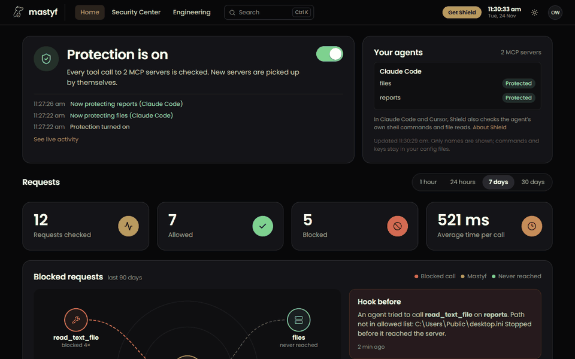
  <br><sub>The local dashboard at <code>http://localhost:4000</code>, recorded from a real install. Every number comes from real tool calls.</sub>
</p>

<table>
  <tr>
    <td width="50%">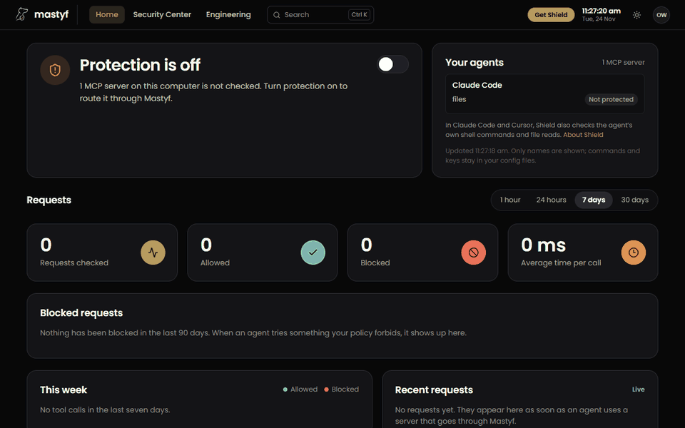</td>
    <td width="50%"></td>
  </tr>
  <tr>
    <td align="center"><sub><b>Protection on.</b> A server added to the agent later is picked up within seconds.</sub></td>
    <td align="center"><sub><b>Try an attack.</b> Your free rules let this one through; Protocol X stops it.</sub></td>
  </tr>
</table>

---

## Quick start

You need **Git** and **Node.js 20 or newer**. Mastyf uses **pnpm**, which comes with Node through Corepack. [Ollama](https://ollama.com/download) is optional and only needed for [Threat Lab](#threat-lab).

```bash
git clone https://github.com/mastyf-ai/mastyf.ai.git
cd mastyf.ai
corepack enable          # makes the pnpm command available
pnpm install             # about two minutes the first time
pnpm dashboard:proxy     # starts Mastyf and the dashboard
```

Open **http://localhost:4000** and sign in as below. The repository ships prebuilt server code (`dist/`) and a prebuilt dashboard, so there is nothing to build. After changing the source, run `pnpm build`, and `pnpm dashboard:build` for the dashboard.

<details>
<summary><b>Windows</b></summary>

`pnpm dashboard:proxy` runs a small shell script, so start it from **Git Bash** (installed with Git for Windows). From PowerShell or Command Prompt, run the same thing directly:

```powershell
node dist/cli.js start --policy default-policy.yaml --blocking-mode block
```

If `corepack enable` asks for administrator rights, run `corepack pnpm install` and `corepack pnpm dashboard:proxy` instead.

</details>

<details>
<summary><b>Linux with Nix</b></summary>

`./setup.sh` installs Nix if needed, enables flakes, installs every dependency, builds the project and adds a `mastyf` shell alias, which starts the same thing as `pnpm dashboard:proxy`.

```bash
chmod +x setup.sh && ./setup.sh
```

</details>

<details>
<summary><b>What starting Mastyf changes on your computer</b></summary>

- Creates `~/.mastyf/dashboard_api_key`, your dashboard key, readable only by you.
- Stores history and accounts in `~/.mastyf-ai/history.db`.
- Starts **Fleet Hub**: one checkpoint for each server config in the top level of `mastyf-ai-configs/`, on local ports 9101 and up. The examples in `mastyf-ai-configs/examples/` are not started; copy one up a level to use it.
- Lists the AI agents on this computer and their MCP servers. It reads names only and changes nothing until you turn [protection](#connect-your-agents) on.

</details>

### Sign in for the first time

The dashboard always asks you to sign in, even on your own computer, so no other program on the machine can read your agents' activity.

<p align="center">
  
</p>

| Step | What to do |
|---|---|
| **1. Get your key** | Run `pnpm dashboard:key`. It prints the key Mastyf created on first start, and where it is stored. Treat it like a password. |
| **2. Create your account** | Open http://localhost:4000, paste the key, choose a username, email and a password (12 characters or more, with upper and lower case, a number and a symbol). |
| **3. Sign in from then on** | With the key, or with your username and password. Other people can get accounts under **Settings, Users**. |

<details id="if-something-goes-wrong">
<summary><b>If something goes wrong</b></summary>

| Problem | What to do |
|---------|------------|
| "That API key does not match this dashboard" | Copy the key again with `pnpm dashboard:key`, the whole line with no spaces. On Windows you can also run `Get-Content "$HOME\.mastyf\dashboard_api_key"`; on macOS or Linux, `cat ~/.mastyf/dashboard_api_key`. |
| You forgot your password | Sign in with the API key. In **Settings, Users**, choose **Reset password** on your account, sign out, sign in with the temporary password it shows, then pick a new one. |
| You lost the key file | Delete `~/.mastyf/dashboard_api_key` and restart Mastyf. A new key is created; your account and history are kept. |
| "Create the first administrator account before signing in with the API key" | Nobody has finished setup yet. Open http://localhost:4000 and do step 2. |
| The page says the Mastyf service is not answering | Mastyf is not running. Start it with `pnpm dashboard:proxy` and refresh. |

</details>

---

## Connect your agents

Open **Home** and turn **Protection** on. Mastyf finds the MCP servers of **Claude Code, Claude Desktop, Cursor, VS Code, Windsurf and Cline**, has them start through its proxy, and keeps watching: a server you add next week is protected within seconds. Restart an agent after its settings change.

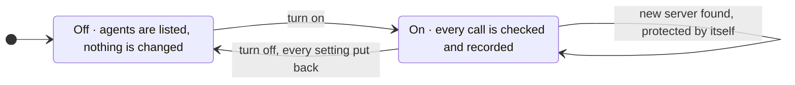

| | What happens |
|---|---|
| **Turning on** | Backs up each agent's settings file next to it, then points its local MCP servers at the proxy. Other settings stay as they are. |
| **While on** | Checks the settings files every few seconds and protects anything new. The choice survives a restart of Mastyf. |
| **Turning off** | Puts the original server entries back. Entries you changed yourself in the meantime are left alone. |
| **Left as they are** | Servers already behind another Mastyf (such as the Shield app), remote URL servers, servers inside a Claude Code project, and servers that use agent variables such as `${workspaceFolder}`. |

> [!TIP]
> **Adding a server to Claude Code?** Use the user scope, so protection picks it up within seconds:
> `claude mcp add --scope user files -- npx -y @modelcontextprotocol/server-filesystem ~/projects`.
> Servers added with the default scope belong to one project and are left as they are.

From the command line, `node dist/cli.js connect` and `node dist/cli.js disconnect` do the same once. For an agent Mastyf does not know, `node dist/cli.js connect --print-config <name> --command "<server command>"` prints the entry to paste into its settings.

> [!TIP]
> **Which files can a connected agent reach?** Only the folders named in the server's own arguments, plus `/home`, `/tmp`, `/workspace` and `/app`. Paths with `..`, and links that lead out of those folders, are refused. Key files, `.env`, `.ssh`, `.aws` and other credential files are refused everywhere. Set `MASTYF_AI_ALLOWED_PATHS` (for example `D:/data/*,D:/work/*`) to use your own list.

---

## How it decides

<picture>
  <source media="(prefers-color-scheme: dark)" srcset="docs/assets/readme/decide-dark.svg">
  
</picture>

<details>
<summary><b>One call, start to finish</b></summary>

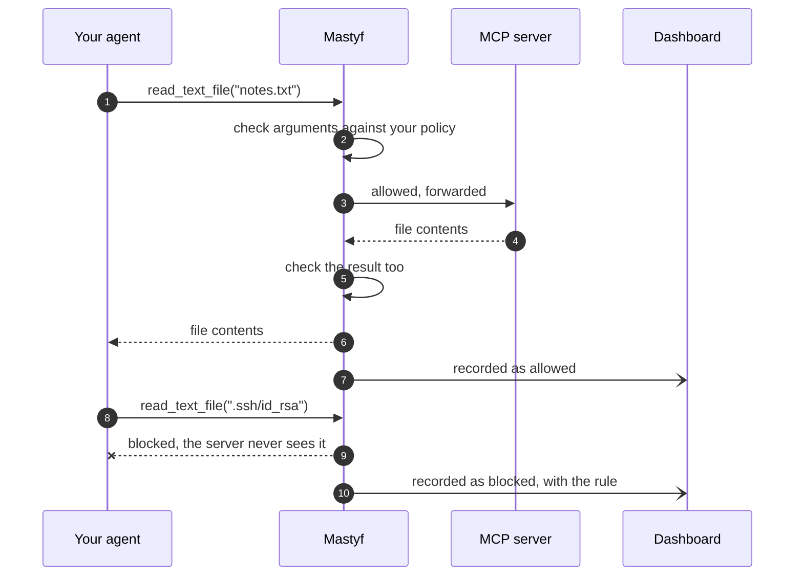

</details>

### What it stops

| Threat | What it looks like |
|--------|--------------------|
| **Prompt injection** | Instructions hidden in tool arguments or results that hijack the agent |
| **Path traversal** | Reads of `/etc/passwd`, `.ssh/id_rsa`, `.aws/credentials` |
| **Secret exfiltration** | API keys and tokens leaking out through tool arguments |
| **Shell injection** | Reverse shells, `rm -rf`, encoded PowerShell |
| **Data exfiltration** | Bulk SQL dumps, `git push`, `aws s3 cp`, unapproved uploads |
| **SSRF** | Calls to cloud metadata endpoints, localhost and private IP ranges |
| **Encoding evasion** | Base64 blobs and Unicode look-alikes used to slip past patterns |
| **Cost abuse** | Runaway agent loops burning through token budgets |
| **Rug-pull attacks** | Tool definitions that quietly change mid-session |

---

## The dashboard

Three tabs, like the Shield app: **Home**, **Security Center** (Activity, Security, Threat Lab, Policy, Logs) and **Engineering** (overview, MCP servers, cost, compliance, settings). Press <kbd>Ctrl</kbd> <kbd>K</kbd> (<kbd>⌘</kbd> <kbd>K</kbd> on a Mac) to jump to any page by name. Dark by default; the light theme is one click away.

<table>
  <tr>
    <td width="50%">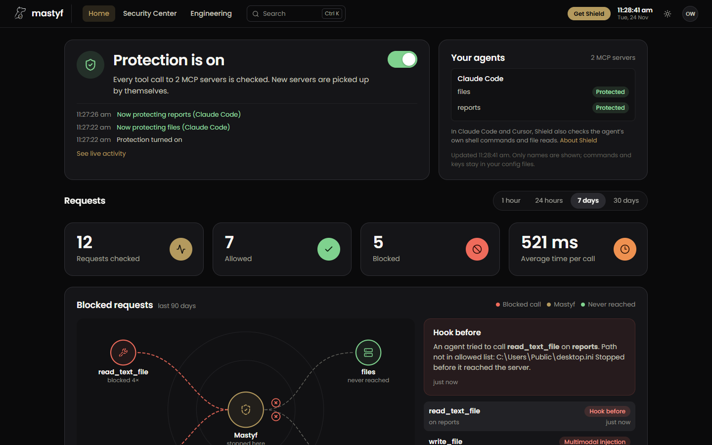</td>
    <td width="50%"></td>
  </tr>
  <tr>
    <td align="center"><sub><b>Home.</b> Is protection on, what was checked, what was stopped.</sub></td>
    <td align="center"><sub><b>Light theme</b>, in the colours of mastyf.ai.</sub></td>
  </tr>
  <tr>
    <td width="50%"></td>
    <td width="50%">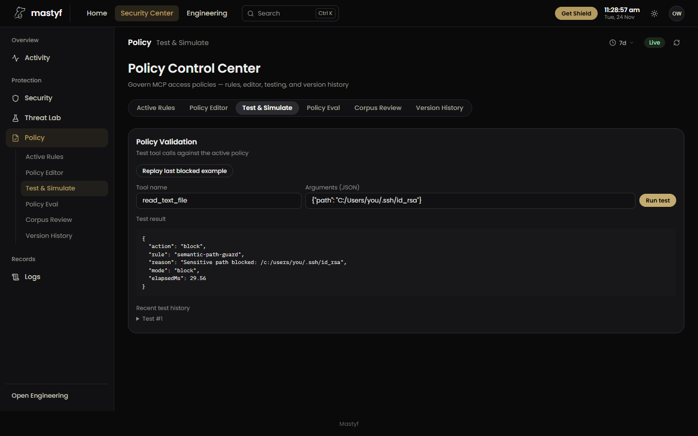</td>
  </tr>
  <tr>
    <td align="center"><sub><b>Activity.</b> Every call, when it happened, and why it was stopped.</sub></td>
    <td align="center"><sub><b>Test a call</b> against your policy before an agent makes it.</sub></td>
  </tr>
  <tr>
    <td width="50%">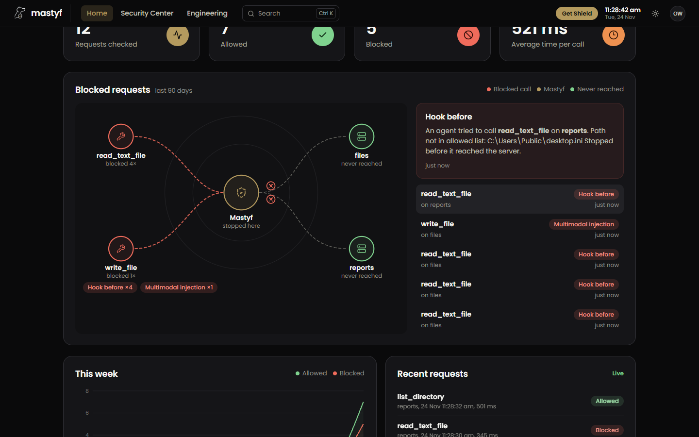</td>
    <td width="50%">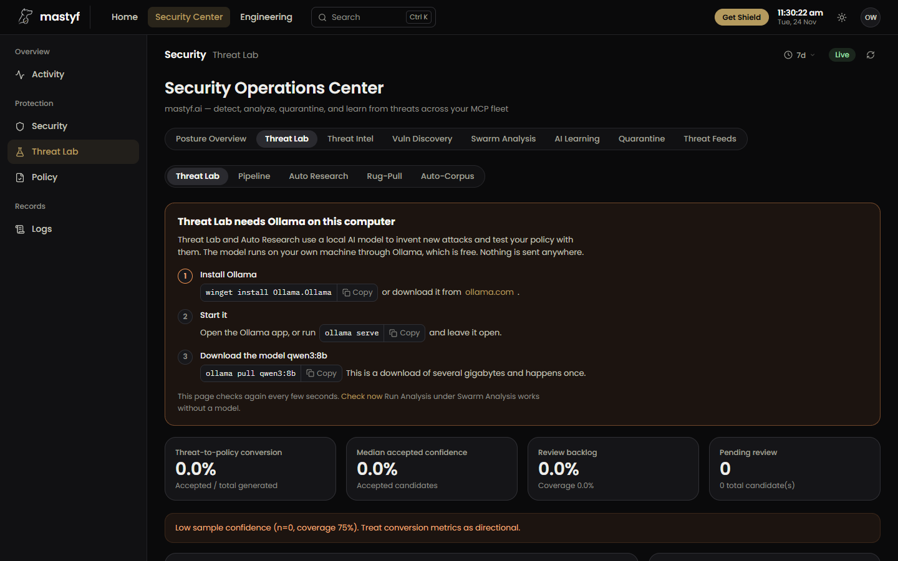</td>
  </tr>
  <tr>
    <td align="center"><sub><b>Blocked requests.</b> What was tried, which rule stopped it, and which server never saw it.</sub></td>
    <td align="center"><sub><b>Threat Lab</b> shows what it still needs before it can run.</sub></td>
  </tr>
  <tr>
    <td width="50%">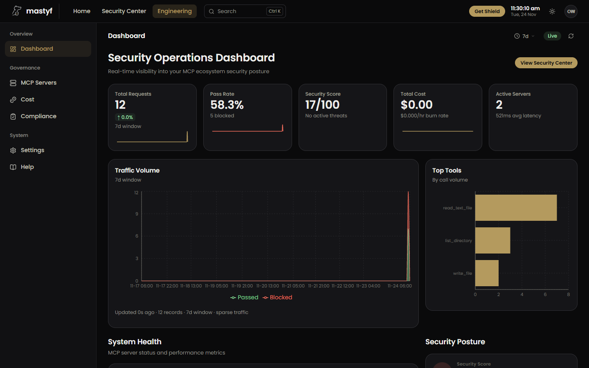</td>
    <td width="50%"></td>
  </tr>
  <tr>
    <td align="center"><sub><b>Engineering overview.</b> Requests, pass rate, cost and traffic.</sub></td>
    <td align="center"><sub><b>Sign-in</b> by API key or by username and password.</sub></td>
  </tr>
</table>

<details>
<summary><b>Every page in the dashboard</b></summary>

| Page | What you can do there |
|-----------|-----------------------|
| **Activity** | Live feed of every tool call, the full audit trail with filters, traffic analytics and infrastructure health |
| **Security** | Security posture, Threat Lab, threat intel, vulnerability discovery, the attack swarm, AI learning, quarantine, threat feeds |
| **Policy** | Active rules (switch any rule on or off), the YAML editor with hot reload, test any tool call, policy eval, corpus review, and **version history** with a diff and one-click restore |
| **MCP Servers** | Inventory, health and latency, certifications, and the tool registry |
| **Cost** | Token usage and spend per server and tool, and a **monthly budget** with an alert threshold |
| **Compliance** | Posture against compliance frameworks, and the evidence files behind it to download |
| **Logs** | Event log, system log and retention |
| **Settings** | Users, groups, roles, SSO, security settings, hooks, the audit log, your profile, cloud link, and the status of **block alerts** (Slack, PagerDuty, any webhook) and **SIEM export** (Splunk, Elastic, OpenTelemetry, syslog) |

Everything on the page updates by itself while it is open. Read the same figures from a script:

```bash
curl -s -H "Authorization: Bearer $(cat ~/.mastyf/dashboard_api_key)" http://localhost:4000/api/protection
```

</details>

### Try an attack against Protocol X

Protocol X is the decision model inside Shield. It reads each tool call and result in context and catches attacks that fixed rules miss. The playground on Home lets you try it: pick what the attacker wants and how they hide it, then send it through.

- **Your rules** check the payload live, on your computer, with your own policy. This is the free policy engine.
- **Protocol X** shows the verdict it gave on that exact text in Mastyf's red-team runs: the probability of an attack and the time it took on a laptop CPU. Every example is a recorded run.
- Edit the text and your rules still check it live. Protocol X reads text it has never seen only inside [Shield](#free-and-shield).

Below the playground, pick an everyday task (summarize a web page, debug a config error, fix a failing test) and watch an attack ride along with it, next to the Shield layer that stops it: DIFC taint tracking, the causal gate or the argument-intent auditor.

---

## Results

<picture>
  <source media="(prefers-color-scheme: dark)" srcset="docs/assets/readme/results-dark.svg">
  
</picture>

| Measure | Result | Source |
|---------|--------|--------|
| Attack defense, AgentDojo | **99.52%** | [Paper](https://doi.org/10.5281/zenodo.22179415), 629 interactive episodes |
| Attack defense, InjecAgent | **98.43%** | [Paper](https://doi.org/10.5281/zenodo.22179415), 4,216 benchmark instances |
| Novel red-team attacks tested | **777** | Mastyf red-team suite, none in the model's training data |
| Ordinary tool calls allowed | **40 of 40** | Benign corpus scored on the same day |
| Rule check, median | **about 1.5 ms** | Laptop CPU, 95th percentile about 5 ms |
| Local corpus, rules only | **285 of 293** attacks blocked, **79 of 79** harmless allowed | `node --import tsx corpus/run-eval.ts` on this repository. The 8 misses are in the deserialization and edge-case sets. |
| Bytes reaching a tool on block | **0** | Complete mediation |

---

## Where Mastyf sits

<picture>
  <source media="(prefers-color-scheme: dark)" srcset="docs/assets/readme/architecture-dark.svg">
  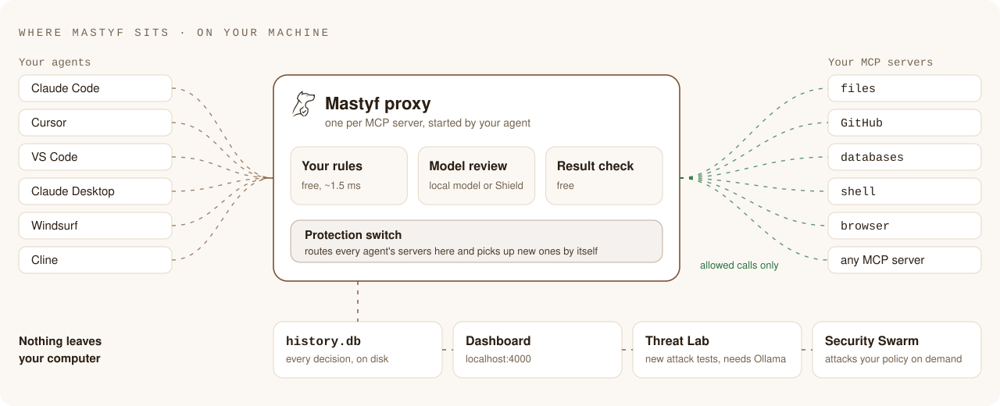
</picture>

The proxy supports five transports: stdio, HTTP, SSE, streamable HTTP and WebSocket. For Redis, Postgres and Kubernetes see [`docs/ENTERPRISE_DEPLOYMENT.md`](docs/ENTERPRISE_DEPLOYMENT.md).

<details>
<summary><b>The Security Swarm: how the rules keep getting harder to bypass</b></summary>

Two swarms work together. The CI Swarm attacks the policy before code ships; the Runtime Swarm enforces and learns from every live call. Four feedback loops connect them. **Run Analysis** in the dashboard runs the parts that test your own install and policy, in about a minute and a half.

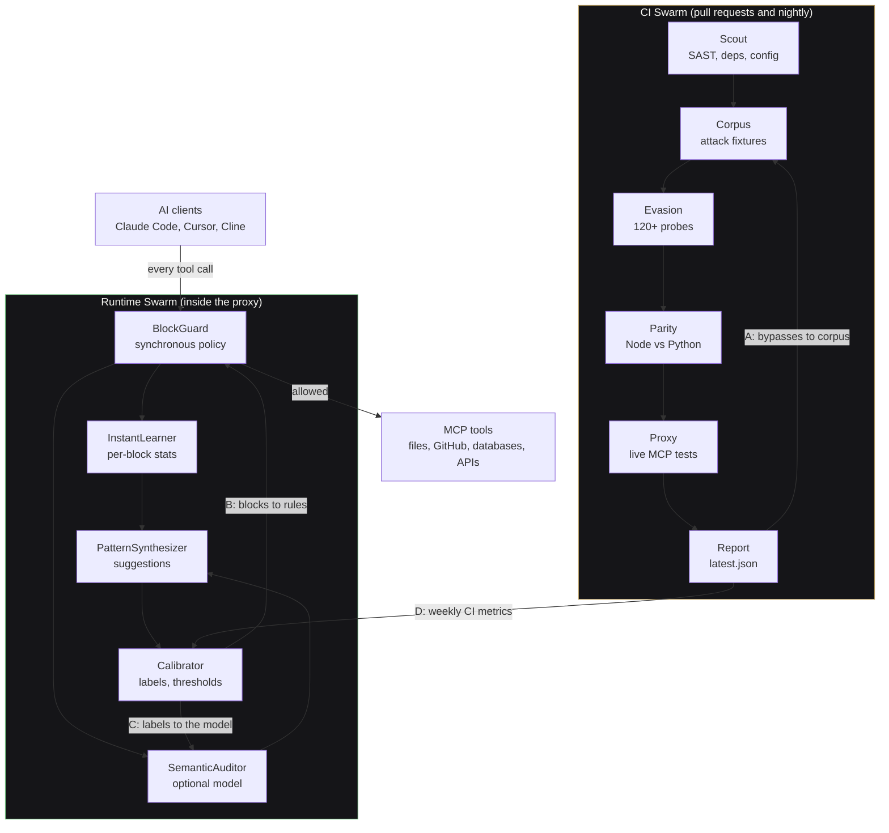

| CI agent | What it does |
|-------|-------------|
| Scout | SAST scan, dependency audit, config review |
| Corpus | Runs every attack and harmless fixture in `corpus/` (372 today) against the current policy |
| Evasion | Runs 120+ bypass probes and generates new ones with a model |
| Parity | Checks the Node and Python engines make identical decisions |
| Proxy | Live stdio MCP session tests against a running proxy |
| Report | Writes `security-swarm/latest.json` with full results |

| Runtime component | What it does |
|-----------|-------------|
| BlockGuard | Enforces the active policy synchronously on every call. Fail-closed. |
| InstantLearner | Tracks per-block statistics and suggests rules as they emerge |
| SemanticAuditor | Optional async model review of calls that pass the patterns but look suspicious |
| PatternSynthesizer | Batches suggestions into candidate rules |
| Calibrator | Labels candidates, tunes thresholds and promotes approved rules into BlockGuard |

| Loop | Signal | Effect |
|------|--------|--------|
| A | CI finds a bypass | Added to the corpus; CI guards against it from then on |
| B | Runtime block pattern | Turned into a new rule and promoted to BlockGuard |
| C | Calibrator label | Used to tune the SemanticAuditor's thresholds |
| D | Weekly CI metrics | Update runtime config so CI and production stay in step |

</details>

---

## Threat Lab

Threat Lab uses a local AI model to invent new attack tests from what it sees, and turns them into proposed rules. Nothing is applied by itself: you review every suggestion in **Security Center, Threat Lab**, and approved ones feed the attack corpus.

> [!IMPORTANT]
> **Threat Lab needs [Ollama](https://ollama.com/download) on your computer.** It is free and runs the model locally, so nothing is sent anywhere. Until it is ready, the Threat Lab page shows these steps and ticks them off as you go. Everything else, including **Run Analysis**, works without it.

| Step | Windows | macOS | Linux |
|---|---|---|---|
| **1. Install** | `winget install Ollama.Ollama` | `brew install ollama` | `curl -fsSL https://ollama.com/install.sh \| sh` |
| **2. Start** | open the Ollama app, or `ollama serve` | `ollama serve` | `ollama serve` |
| **3. Download the model, once** | `ollama pull qwen3:8b` | `ollama pull qwen3:8b` | `ollama pull qwen3:8b` |

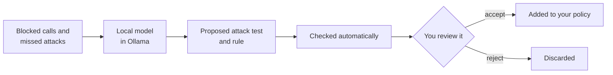

`pnpm dashboard:proxy` points Mastyf at `http://127.0.0.1:11434`. Set `OLLAMA_BASE_URL` or `MASTYF_AI_LLM_MODEL` before starting to use another address or model.

---

## Policy

Your rules live in `default-policy.yaml`. You own them; Mastyf enforces them. Edit them in the dashboard (**Policy, Policy Editor**) or any text editor; changes reload by themselves, and every save from the dashboard is kept in **Version history**.

```yaml
policy:
  mode: block
  default_action: pass
  unicode_strict: true
  rules:
    - name: block-sensitive-paths
      action: block
      argPatterns:
        - field: path
          patterns: ['^/etc/', '/\.ssh', '/\.aws/credentials']

    - name: rate-limit-tool-calls
      action: block
      maxCallsPerMinute: 120

    - name: block-shell-injection
      action: block
      patterns: ['rm\s+-rf', 'curl\s', 'wget\s', '`[^`]+`']
```

| Mode | What it does | When to use it |
|------|----------|-------------|
| `audit` | Logs everything, blocks nothing | First week: learn what your agents do |
| `warn` | Logs and flags, still forwards | Tuning before you enforce |
| `block` | Stops violations before they run | Day to day |

Templates for HIPAA, PCI-DSS, GxP and data residency are in [`policy-templates/`](policy-templates/).

---

## Free and Shield

Everything in this repository is free and open source under AGPL-3.0 and runs on your own machines, with no account. The paid **Mastyf Shield** plan adds the desktop app, Protocol X and the layers that need Mastyf's servers.

| | Free | Shield |
|---|:---:|:---:|
| Policy engine: blocked paths, secret and data-leak patterns, injection patterns, tool fingerprints (about 1.5 ms per call) | ✓ | ✓ |
| This local dashboard, with the protection switch for your agents' MCP servers | ✓ | ✓ |
| Security Swarm, Run Analysis and Threat Lab attack tests | ✓ | ✓ |
| Python library (`pip install mastyf-ai`) with LangChain and OpenAI Agents adapters | ✓ | ✓ |
| Check service any agent in any language can call | ✓ | ✓ |
| GitHub Copilot hooks | ✓ | ✓ |
| Shield desktop app: finds your agents and protects them with no code changes | | ✓ |
| Automatic protection for Claude Code, Cursor and VS Code, including the agent's own shell commands and file reads | | ✓ |
| Protocol X model checks on calls your rules allow | | ✓ |
| DIFC taint tracking: untrusted data cannot flow out | | ✓ |
| Argument-intent auditor: arguments must match what you asked for | | ✓ |
| Causal gate: stops calls set off by untrusted content instead of by you | | ✓ |
| mastyf.ai dashboard and hosted check API | | ✓ |

Plans and prices: **[mastyf.ai/pricing](https://www.mastyf.ai/pricing)**.

> [!NOTE]
> **Enterprise and cloud:** Mastyf runs as a native `CONTENT_AUTHZ` Service Extension for **Google Cloud Agent Gateway** (`us-central1`), with distributed Redis state, sub-second fail-closed enforcement and BigQuery audit logging. See the [Google Agent Gateway runbook](deploy/GOOGLE_AGENT_GATEWAY.md).

---

## More tools

<details>
<summary><b>Python gateway and protected agent</b></summary>

A separate Python package runs the reference monitor, MCP discovery and a plain-English protected agent:

```bash
cd mastyf_gateway
pip install -e .
mastyf                     # first run: discovers your tools, asks what to allow, then starts the agent
```

| Command | What it does |
|---------|-------------|
| `mastyf -m "Find unpaid customer invoices"` | Run one query without the interactive prompt |
| `mastyf policy "Allow reading invoices, but never delete data or make HTTP calls"` | Propose a policy change in plain English |
| `mastyf policy status` | Compare the proposed policy with the active one |
| `mastyf policy activate` | Make the proposed policy active |
| `mastyf proxy -- uvx mcp-server-sqlite --db /tmp/test.db` | Put Mastyf in front of any MCP server over stdio |
| `mastyf audit verify --ledger ~/.mastyf/receipts.jsonl` | Verify the tamper-evident receipt ledger |
| `mastyf demo --scenario all` | Run the action-boundary failure demonstrations |

Every non-allowed action dispatches **0 bytes** to the tool backend, and every decision gets a signed receipt.

</details>

<details>
<summary><b>MCP package trust scores</b></summary>

Before installing an MCP server from npm, check its trust score at [mastyf.ai/certified](https://www.mastyf.ai/certified): known CVEs, typo-squat risk, maintainer signals and known attack patterns. Free, no account needed.

</details>

## Reference

<details>
<summary><b>Common commands</b></summary>

| Command | What it does |
|---------|-------------|
| `pnpm dashboard:proxy` | Start Mastyf (Fleet Hub) and the dashboard on port 4000 |
| `pnpm dashboard:key` | Print your dashboard API key and where it is stored |
| `pnpm dashboard:key --path` | Print only where the key file is |
| `node dist/cli.js start` | The same start-up, without the shell script (handy on Windows) |
| `node dist/cli.js connect` / `disconnect` | Route your agents' MCP servers through Mastyf, or put them back |
| `node dist/cli.js doctor` | Check the database, policy and environment |
| `node dist/cli.js scan --all` | Scan MCP configs for CVEs and injection risks |
| `pnpm dashboard:build` | Rebuild the dashboard after changing its source |
| `pnpm build` | Rebuild the server after changing its source |
| `pnpm test` | Run the full test suite |
| `pnpm security-swarm:fast` | Quick security regression, 5 to 15 minutes |
| `pnpm security-swarm:analyze` | Full adversarial analysis |

</details>

<details>
<summary><b>Configuration</b></summary>

Set these in the environment before starting Mastyf. All are optional.

| Variable | Default | What it does |
|----------|---------|--------------|
| `DASHBOARD_PORT` | `4000` | Port of the dashboard and its API |
| `MASTYF_HOME` | `~/.mastyf` | Folder that holds `dashboard_api_key` |
| `MASTYF_AI_DB_PATH` | `~/.mastyf-ai/history.db` | History and accounts database. The proxy and the dashboard must use the same one. |
| `MASTYF_AI_ALLOWED_PATHS` | folders named by each server | Folders connected agents may reach, comma separated, `*` as a wildcard |
| `MASTYF_AI_COST_BUDGET_USD` | none | Monthly spend budget. A budget saved in **Cost, Budgets** overrides it. |
| `ALERT_SLACK_WEBHOOK`, `ALERT_PAGERDUTY_KEY`, `ALERT_GENERIC_WEBHOOK` | none | Where block alerts are sent |
| `MASTYF_AI_SIEM_ENABLED`, `MASTYF_AI_SIEM_PROTOCOL`, `MASTYF_AI_SIEM_ENDPOINT` | off | Forward every decision to your SIEM (`cef`, `syslog` or `splunk-hec`) |
| `MASTYF_AI_CONTROL_PLANE_URL`, `MASTYF_AI_CLOUD_API_KEY`, `MASTYF_AI_TENANT_ID` | none | Link this install to your mastyf.ai workspace. See [Connect](https://www.mastyf.ai/docs/connect). |
| `OLLAMA_BASE_URL`, `MASTYF_AI_LLM_PROVIDER`, `MASTYF_AI_LLM_MODEL` | `http://127.0.0.1:11434` and `qwen3:8b` | Local model for Threat Lab and semantic review |
| `DASHBOARD_AUTH_DISABLED` | `false` | Turns off dashboard sign-in. Only for isolated local tests; refused on any address other than localhost. |

</details>

<details>
<summary><b>Troubleshooting</b></summary>

| Problem | Fix |
|---------|-----|
| Sign-in problems | See [If something goes wrong](#if-something-goes-wrong) |
| Dashboard shows no data | The proxy and the dashboard must share the same `MASTYF_AI_DB_PATH` (default `~/.mastyf-ai/history.db`). Numbers also depend on the period picked on the page. |
| Home says protection is on but nothing appears | Restart the agent so it starts its servers through Mastyf, then use a tool. |
| Port 4000 is already in use | Stop the other program, or start with `DASHBOARD_PORT=4100 pnpm dashboard:proxy` |
| `pnpm: command not found` | Run `corepack enable`, or put `corepack` in front of each pnpm command |
| `sh: command not found` on Windows | Start from Git Bash, or use `node dist/cli.js start --policy default-policy.yaml --blocking-mode block` |
| `dist/cli.js` not found | Run `pnpm build` |
| Threat Lab says it needs Ollama | Follow the three steps in [Threat Lab](#threat-lab). The page updates by itself when Ollama is ready. |
| `npm install` fails | Use `pnpm install`; the npm package is not published yet |

</details>

## Learn more

[Enterprise deployment](docs/ENTERPRISE_DEPLOYMENT.md) · [Dashboard runbook](docs/DASHBOARD_CANONICAL_RUNBOOK.md) · [Defense pipeline in depth](docs/DEFENSE_FABRIC.md) · [Security Swarm](security-swarm/README.md) · [Real-world MCP integration](docs/REAL_WORLD_INTEGRATION.md) · [Core detection engine](packages/core/README.md)

## Research paper and citation

If you use Mastyf Guard, its benchmark method or the Cognitive Harvard Architecture in research or production, please cite the open-access paper:

[](https://doi.org/10.5281/zenodo.22179415)

> **Das, R. (2026).** *Cognitive Harvard Architectures for AI Agent Perimeter Defense: Resolving the Confused Deputy Problem in Model Context Protocol via Capability-Based Access Control.* **Zenodo**. doi: [10.5281/zenodo.22179415](https://doi.org/10.5281/zenodo.22179415).

```bibtex
@article{das2026cognitive,
  title={Cognitive Harvard Architectures for AI Agent Perimeter Defense: Resolving the Confused Deputy Problem in Model Context Protocol via Capability-Based Access Control},
  author={Das, Rudraneel},
  journal={Zenodo},
  year={2026},
  doi={10.5281/zenodo.22179415},
  url={https://doi.org/10.5281/zenodo.22179415}
}
```
